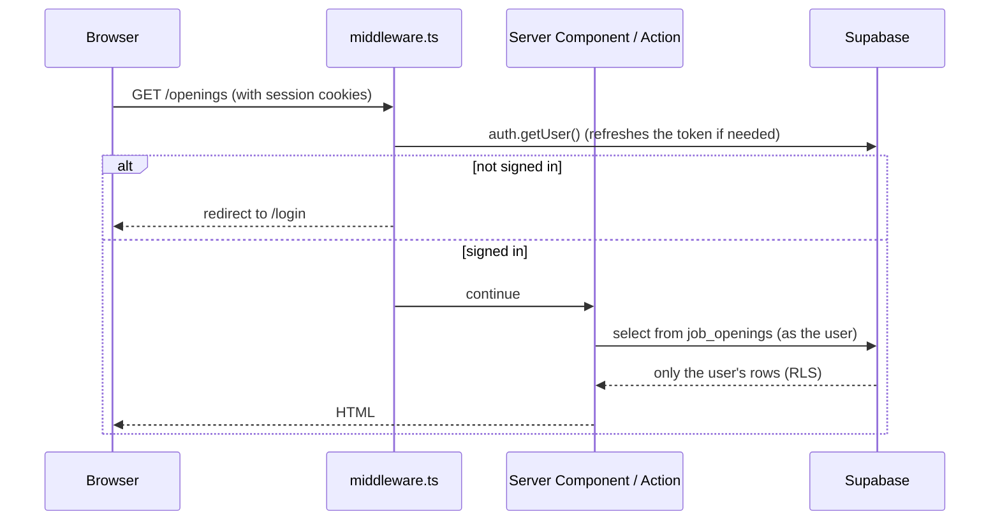

# Architecture

Job Finder is a single-user web app. It tracks job applications, and it runs an agent every morning that finds openings and scores how well each fits the owner's CV.

## Stack

| Layer | Choice | Why |
| --- | --- | --- |
| Framework | **Next.js 15** (App Router), React 19, TypeScript | Server Components and Server Actions keep data access on the server with very little API code. Route handlers cover the cron endpoint. Chosen over Nuxt 4 so the project also shows React experience. |
| Styling | **Tailwind CSS 4** | Fast to build a responsive, mobile-first UI. Colors are CSS variables in `globals.css`, so dark mode follows the system setting. |
| Database and auth | **Supabase** (Postgres + Auth) | Free hosted Postgres with built-in email sign-in and row-level security, so the database enforces data isolation itself. |
| AI | **Claude** via `@anthropic-ai/sdk` | Scores each job against the CV and returns structured JSON. The default model is Claude Haiku 5.5, which is cheap and good enough for a fit judgment. |
| Job data | **JSearch** (RapidAPI), **Remotive**, **RemoteOK** | JSearch covers Google for Jobs, which includes LinkedIn and Indeed, without scraping those sites. Remotive and RemoteOK add remote-only roles for free. |
| Validation | **zod** | Validates form input and defines the schema for Claude's structured output. |
| Tests | **Vitest** | Unit tests for pure logic: parsers, scoring helpers, pagination, validation and stats. |
| Hosting | **Vercel** (planned) | First-class Next.js hosting, with built-in cron jobs for the daily search. |
| CI | **GitHub Actions** | Lint, typecheck, tests and a production build on every PR. |

## Folder layout

```
src/
  middleware.ts            Refreshes the Supabase session; redirects signed-out visitors to /login
  app/
    layout.tsx             Header and navigation
    page.tsx               Applications dashboard: stats, status filters, list
    applications/          Add, edit and delete forms, the tailored email and CV, and /applications/<id>/cv (PDF)
    openings/              Openings list (Good matches / Below 40% tabs), Select checkboxes, "Apply to selected", "Find jobs now", Dismiss
    settings/              Master CV and search queries
    login/                 Magic-link sign-in form and server action
    auth/callback/         Swaps the emailed code for a session
    auth/signout/          Ends the session
    api/cron/find-jobs/    Daily agent run, called by Vercel Cron
  components/              Shared UI: ApplicationForm, StatusBadge, Pagination
  lib/
    supabase/server.ts     Supabase client bound to the signed-in user's cookies
    supabase/admin.ts      Service-role client for the cron job (bypasses RLS)
    jobs/                  The agent: sources, text helpers, scoring, run orchestration
    apply/                 Applying: tailoring with Claude, CV PDF, Gmail sending, run orchestration
    anthropic.ts           Shared Claude request options
    concurrency.ts         Runs async work a few at a time
    types.ts               Shared types and labels
    validation.ts          zod schema for the application form
    stats.ts               Dashboard numbers
    pagination.ts          Page parsing and ranges
supabase/migrations/       SQL to run in Supabase, in order
docs/                      This documentation
```

## How a request flows



- **Reads** happen in Server Components through `createClient()` from `lib/supabase/server.ts`. That client acts as the signed-in user, so row-level security limits every query to their own rows.
- **Writes** go through Server Actions (`"use server"` files). They validate input with zod, write to Supabase, then call `revalidatePath` so the page shows fresh data.
- **There's no separate REST API.** The only route handlers are the auth callback, sign-out and the cron endpoint.

## Why this shape

- **Server-first.** Keys stay on the server, and the browser only receives rendered HTML plus small client components for forms and buttons.
- **The database enforces security.** Row-level security means a bug in a query can't leak another user's data. The app has one user today, but the rules still apply.
- **Cheap to run.** Supabase, Vercel and JSearch all have free tiers. The only metered cost is Claude, at roughly $0.15 per agent run on Haiku.
- **Pure logic is tested in isolation.** Source parsers, text helpers and pagination are plain functions with unit tests. Code that touches the network or the database stays thin.
