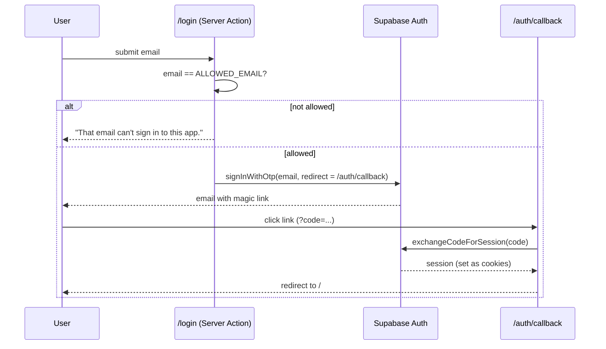

# Authentication

## Summary

- **Passwordless sign-in.** Supabase sends a magic link by email.
- **Single owner.** Only the address in `ALLOWED_EMAIL` can request a link.
- **Sessions live in cookies** and are managed by `@supabase/ssr`. The middleware refreshes them on every request.
- **Every page is private** except `/login`, `/auth/*` and `/api/cron/*`.
- **Data isolation is enforced in Postgres** with row-level security (RLS), not just in app code.
- **The daily cron job** authenticates with a shared secret and uses a service-role key.

## Sign-in flow



| Step | Code |
| --- | --- |
| Form and allow-list check | `src/app/login/page.tsx`, `src/app/login/actions.ts` |
| Code exchange | `src/app/auth/callback/route.ts` |
| Sign out (POST) | `src/app/auth/signout/route.ts` |

### Why magic links

- No passwords to store, reset or leak.
- Supabase handles email delivery, token expiry and rate limiting.
- One user signing in on a few devices doesn't need anything heavier.

### Why `ALLOWED_EMAIL`

Supabase lets anyone sign up by default. The allow-list check in the login action stops strangers from creating accounts. For extra safety, you can also turn off "Allow new users to sign up" in Supabase → Authentication → Providers → Email once your own account exists.

## Sessions and middleware

`src/middleware.ts` runs on every request except static assets. It:

1. Creates a Supabase server client bound to the request cookies.
2. Calls `supabase.auth.getUser()`. This validates the access token with Supabase and refreshes it when it's close to expiring. New cookies are written to the response.
3. Redirects to `/login` when there's no user and the path isn't public.

It uses `getUser()` rather than `getSession()` because `getUser()` checks the token with Supabase instead of trusting the cookie contents.

Server Components and Server Actions use `createClient()` from `src/lib/supabase/server.ts`. Cookies are read-only in Server Components, so its `setAll` swallows errors there. The middleware has already refreshed the session by then.

## Authorization: row-level security

Every table has RLS enabled. Each table has one policy that lets a row through only when `user_id = auth.uid()`:

```sql
create policy "own applications" on applications
  for all using (user_id = auth.uid()) with check (user_id = auth.uid());
```

- `user_id` defaults to `auth.uid()`, so inserts from the app don't need to set it.
- The anon (publishable) key is safe in the browser because RLS limits it to the signed-in user's rows.

## The daily cron job

The cron route has no user session, so it authenticates differently:

| Concern | How it's handled |
| --- | --- |
| Who can call it | Vercel Cron sends `Authorization: Bearer $CRON_SECRET`. Any other request gets `401`. |
| Database access | `createAdminClient()` in `src/lib/supabase/admin.ts` uses `SUPABASE_SERVICE_ROLE_KEY`, which **bypasses RLS**. |
| Keeping it safe | The service-role key is server-only and never prefixed with `NEXT_PUBLIC_`. The agent code filters every query by `user_id`. |

The "Find jobs now" button doesn't need the service-role key. It runs as the signed-in user, under RLS.

## Keys at a glance

| Key | Where it's used | Safe in the browser? |
| --- | --- | --- |
| `NEXT_PUBLIC_SUPABASE_URL` | Everywhere | Yes |
| `NEXT_PUBLIC_SUPABASE_ANON_KEY` (publishable) | Everywhere | Yes, because RLS protects data |
| `SUPABASE_SERVICE_ROLE_KEY` (secret) | Cron route only | **No** |
| `CRON_SECRET` | Cron route only | **No** |
| `ALLOWED_EMAIL` | Login action | Server-only |
