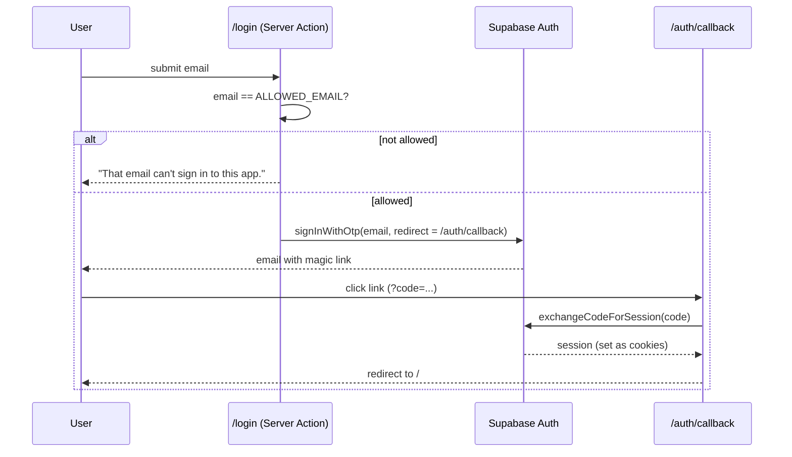

# Authentication

## Summary

- **Passwordless sign-in.** Supabase sends a magic link by email.
- **Invite-only.** Only addresses in `ALLOWED_EMAILS` can request a link, and the middleware rejects any session whose email isn't on the list.
- **Sessions live in cookies** and are managed by `@supabase/ssr`. The middleware refreshes them on every request.
- **Every page is private** except `/login`, `/auth/*` and `/api/cron/*`.
- **Data isolation is enforced in Postgres** with row-level security (RLS), not just in app code.
- **The daily cron job** authenticates with a shared secret and uses a service-role key.

## Sign-in flow



| Step | Code |
| --- | --- |
| Form and allow-list check | `src/app/login/page.tsx`, `src/app/login/actions.ts` |
| Code exchange | `src/app/auth/callback/route.ts` |
| Sign out (POST) | `src/app/auth/signout/route.ts` |

### Why magic links

- No passwords to store, reset or leak.
- Supabase handles email delivery, token expiry and rate limiting.
- One user signing in on a few devices doesn't need anything heavier.

### Why `ALLOWED_EMAILS`

Supabase lets anyone sign up by default, and the anon key is public (it's in the browser), so a stranger can create an account by calling Supabase directly, without the login page. The list is checked in three places:

1. **Login action:** only listed emails get a sign-in link.
2. **Middleware:** a session whose email isn't listed is signed out and sent to `/login`. This also covers server actions, so a stranger can't run the agent on your API keys.
3. **Cron:** only listed accounts are searched for.

If the variable is empty, nobody gets in. The older single `ALLOWED_EMAIL` still works.

For extra safety, turn off "Allow new users to sign up" in Supabase → Authentication → Sign In / Providers once everyone has signed in once. Existing users can still sign in.

## Sessions and middleware

`src/middleware.ts` runs on every request except static assets. It:

1. Creates a Supabase server client bound to the request cookies.
2. Calls `supabase.auth.getClaims()`. This verifies the access token's signature and refreshes it when it's close to expiring. New cookies are written to the response. With Supabase's asymmetric JWT signing keys the check happens locally, with no round trip to Supabase Auth. With the legacy shared secret it asks Supabase Auth, like `getUser()`.
3. Redirects to `/login` when there's no user and the path isn't public.

It uses `getClaims()` rather than `getSession()` because `getClaims()` verifies the token's signature instead of trusting the cookie contents. Server actions that need the user's id still call `getUser()`.

Server Components and Server Actions use `createClient()` from `src/lib/supabase/server.ts`. Cookies are read-only in Server Components, so its `setAll` swallows errors there. The middleware has already refreshed the session by then.

## Authorization: row-level security

Every table has RLS enabled. Each table has one policy that lets a row through only when `user_id = auth.uid()`:

```sql
create policy "own applications" on applications
  for all using (user_id = auth.uid()) with check (user_id = auth.uid());
```

- `user_id` defaults to `auth.uid()`, so inserts from the app don't need to set it.
- The anon (publishable) key is safe in the browser because RLS limits it to the signed-in user's rows.

## The daily cron job

The cron route has no user session, so it authenticates differently:

| Concern | How it's handled |
| --- | --- |
| Who can call it | Vercel Cron sends `Authorization: Bearer $CRON_SECRET`. Any other request gets `401`. |
| Database access | `createAdminClient()` in `src/lib/supabase/admin.ts` uses `SUPABASE_SERVICE_ROLE_KEY`, which **bypasses RLS**. |
| Keeping it safe | The service-role key is server-only and never prefixed with `NEXT_PUBLIC_`. The agent code filters every query by `user_id`. |

The "Find jobs now" button doesn't need the service-role key. It runs as the signed-in user, under RLS.

## Keys at a glance

| Key | Where it's used | Safe in the browser? |
| --- | --- | --- |
| `NEXT_PUBLIC_SUPABASE_URL` | Everywhere | Yes |
| `NEXT_PUBLIC_SUPABASE_ANON_KEY` (publishable) | Everywhere | Yes, because RLS protects data |
| `SUPABASE_SERVICE_ROLE_KEY` (secret) | Cron route only | **No** |
| `CRON_SECRET` | Cron route only | **No** |
| `ALLOWED_EMAILS` | Login action, middleware, cron | Server-only |
| `GMAIL_APP_PASSWORD` | Apply action only | **No.** It can send mail as you. Revoke it at myaccount.google.com/apppasswords if it leaks. |
