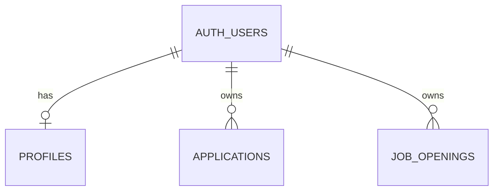

# Data model

All tables live in Supabase Postgres, in the `public` schema. Migrations are in `supabase/migrations/` and are run by hand, in order, in the Supabase SQL Editor.

## `applications`

Jobs you've applied to (or saved to apply to). Created in `0001_init.sql`.

| Column | Type | Notes |
| --- | --- | --- |
| `id` | uuid | Primary key |
| `user_id` | uuid | Defaults to `auth.uid()`; RLS key |
| `company`, `role` | text | Required |
| `url`, `source`, `location`, `salary` | text | Optional |
| `work_mode` | enum | `remote`, `hybrid`, `onsite` |
| `employment_type` | enum | `full_time`, `part_time`, `contract`, `freelance` |
| `status` | enum | `saved`, `applied`, `interviewing`, `offer`, `rejected`, `ghosted` (shown as "No response"), `withdrawn` |
| `applied_on` | date | |
| `feedback`, `notes` | text | |
| `created_at`, `updated_at` | timestamptz | `updated_at` is set by a trigger |

## `job_openings`

Every listing the agent has scored. Created in `0001`, extended in `0002`.

| Column | Type | Notes |
| --- | --- | --- |
| `id` | uuid | Primary key |
| `user_id` | uuid | RLS key. `(user_id, url)` is unique, so the same listing is never saved twice. |
| `title`, `company`, `url`, `source` | text | Required |
| `location`, `salary`, `description` | text | |
| `work_mode`, `employment_type` | enum | Same enums as `applications` |
| `external_id` | text | Source-specific ID, for example `jsearch:abc` |
| `apply_email` | text | First usable email found in the listing. Used by step 4 to apply by email. |
| `posted_at` | timestamptz | From the source, when given |
| `fit_score` | smallint | 0–100, from Claude |
| `fit_reason` | text | One or two sentences from Claude |
| `dismissed` | boolean | Set by the Dismiss button |
| `selected` | boolean | Reserved for step 4 (the apply toggle) |
| `discovered_at` | timestamptz | When the agent found it |

**Why low scores are stored too:** if jobs scoring under 40 weren't saved, every run would re-score the same listings and pay for it again. They're saved, and the Openings page shows them in the "Below 40%" tab.

## `profiles`

One row per user with the agent's inputs. Created in `0002_job_agent.sql`.

| Column | Type | Notes |
| --- | --- | --- |
| `user_id` | uuid | Primary key; RLS key |
| `cv_markdown` | text | The master CV the agent scores against |
| `search_queries` | text[] | JSearch searches; a city or country in the text switches JSearch's country |
| `updated_at` | timestamptz | Trigger-managed |

The CV lives in the database rather than the repo, so personal details stay out of source control.

## Row-level security

Every table has RLS on, with one policy each: a row is visible and writable only when `user_id = auth.uid()`. See [Authentication](authentication.md#authorization-row-level-security).

## Adding a migration

1. Add `supabase/migrations/000N_description.sql`.
2. Run it in the Supabase SQL Editor.
3. If Supabase reports "Could not find the table ... in the schema cache", run `notify pgrst, 'reload schema';`.
