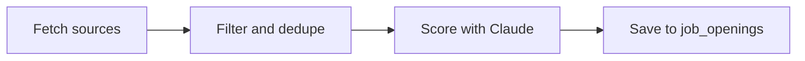

# Job-finding agent

The agent fills the Openings page. It runs every morning through Vercel Cron, and on demand when you press **Find jobs now**.

## Pipeline

Code: `src/lib/jobs/run.ts` (`runJobSearch`).

### 1. Fetch

| Source | File | What it returns | Notes |
| --- | --- | --- | --- |
| Remotive | `sources/remotive.ts` | Up to 150 remote software-dev jobs | One call per run, because Remotive asks for few requests a day. Free. |
| RemoteOK | `sources/remoteok.ts` | About 100 latest remote jobs | One call per run. The first array item is a legal notice and is skipped. Free. |
| JSearch | `sources/jsearch.ts` | 10 jobs per saved search | Google for Jobs, which covers LinkedIn, Indeed and company sites. Uses `GET /search-v2` on `jsearch.p.rapidapi.com`. Results arrive in `data.jobs`. Needs `JSEARCH_API_KEY`. |

The sources are fetched in parallel with `Promise.allSettled`, so one failing source doesn't stop the others. Each failure appears as an orange line under the Find jobs now button.

**JSearch country:** JSearch searches the US unless told otherwise. `countryFor()` sets `country=qa`, `ph` or `ae` when a search mentions Qatar/Doha, the Philippines/Manila/Cebu or the UAE/Dubai/Abu Dhabi.

### 2. Filter and dedupe

`selectCandidates()` drops:

- URLs already in `job_openings` or `applications`
- Duplicate URLs within the run
- Titles that clearly aren't engineering roles (`isRelevantTitle()`), so no Claude calls are spent on them

It then sorts newest first and keeps the first **150**.

### 3. Score with Claude

`scoreJob()` in `src/lib/jobs/score.ts`:

- **Model:** `claude-haiku-5-5` by default. Override it with `ANTHROPIC_MODEL`.
- **Effort:** `low`. Fit scoring is a quick judgment.
- **Structured output:** `client.beta.messages.parse` with a zod schema `{ score: 0–100, reason, work_mode }`, so the result is always valid JSON.
- **Prompt:** the system prompt holds the scoring rubric and your preferences:
  1. Remote (any country)
  2. Hybrid
  3. On-site in Qatar only

  On-site or hybrid roles outside Qatar score 20 or lower. The CV is a second system block marked for prompt caching. The job listing, trimmed to 6,000 characters, is the user message.
- **Refusals:** if Claude declines, the job is skipped. Larger models also get `fallbacks: "default"`, which re-runs a declined request on another model. Haiku doesn't support it, so it isn't sent.
- **Concurrency:** 10 jobs at a time.

### 4. Save

Every scored job is upserted into `job_openings`, ignoring duplicates on `(user_id, url)`. The summary counts jobs scoring **40 or more** as good matches.

## Costs and limits

| Item | Per run | Notes |
| --- | --- | --- |
| Claude (Haiku 5.5) | About $0.15 for 150 jobs | About 3,500 input tokens and a few hundred output tokens per job. Opus is roughly 30x the price. |
| JSearch | 1 request per saved search | 7 searches × 30 days ≈ 210 requests a month. Check your RapidAPI plan's limit. |
| Remotive, RemoteOK | Free | |
| Function time | Up to 300 seconds | `maxDuration = 300` on the cron route and the Openings page |

These are estimates. Check the Anthropic Console and the RapidAPI dashboard for real usage.

## Tuning

| Want | Change |
| --- | --- |
| More or fewer jobs scored per run | `MAX_SCORED_PER_RUN` in `run.ts` |
| A different "good match" bar | `MIN_FIT_SCORE` in `run.ts` |
| Different searches | Settings page |
| A stronger model | Set `ANTHROPIC_MODEL=claude-sonnet-5-5` or `claude-opus-5-5` |
| A new country for local searches | Add a pattern to `COUNTRY_HINTS` in `sources/jsearch.ts` |
